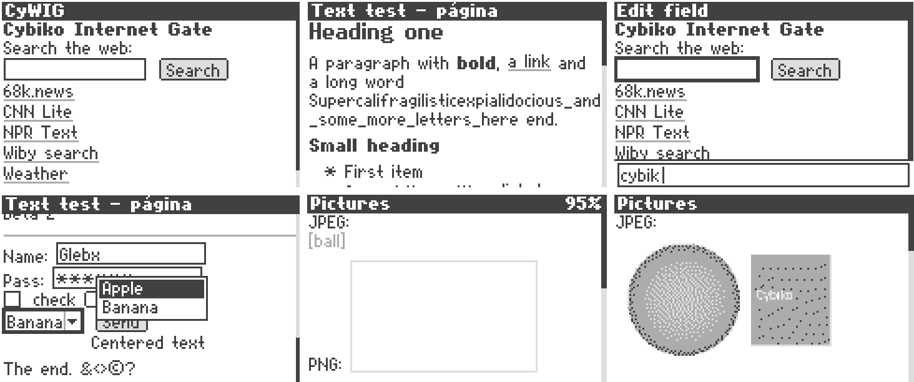
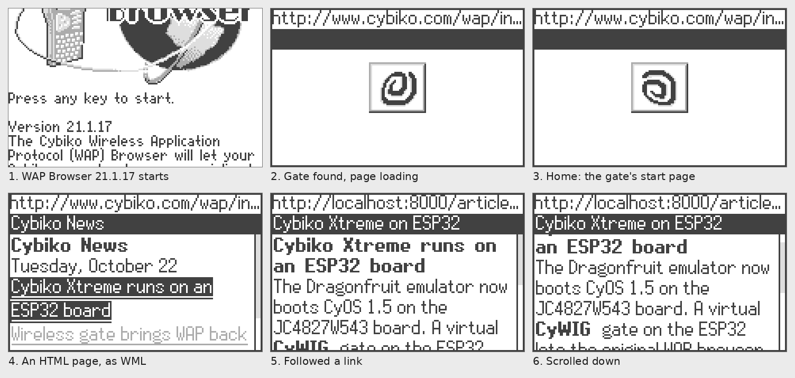

# Cybiko browser

> **Experimental.** Tested only in the Dragonfruit emulator, on a PC and on
> the JC4827W543 ESP32-S3 board. It has not been tried on a real Cybiko
> yet.

A small web browser for the emulated Cybiko Xtreme in
[Dragonfruit](https://github.com/sovgvd/dragonfruit-jc4827w543-esp32), the
Palm OS and Cybiko emulator for the JC4827W543 ESP32-S3 board.

**Browser** is a native CyOS application on the Cybiko (`cyapp/`). It
gets web pages from a Cybiko Internet Gate over the Cybiko radio, the way
the Xtreme's own WAP browser does, and the gate (`gate/`) runs on the
ESP32 next to the emulator, fetching over the board's Wi-Fi. The Xtreme's
WAP browser uses the same gate.

It shows plain HTML pages on the Cybiko's 160x100 screen: text in CyOS's
own fonts with bold and headings, lists, links, preformatted text, rules
and forms (text, password, check boxes, radio buttons, lists, GET and
POST). Pictures are shown as frames or their `alt` text until **Load
pictures** in the menu: then the gate fetches the pictures of the part on
screen (at most six, each scaled to at most 120x80 in four grays) and sends
the part again with them, which takes about half a minute over the radio. Scripts and style
sheets are not run, so the sites made for old or small screens (FrogFind,
68k.news, text-only news sites) work best.



*Browser in the emulator. Top row: the gate's home page, a test page, and
typing into the search field. Bottom row: a form with a list open, then a
page before and after **Load pictures**.*

## How it works

The gate does the web and the Cybiko only draws. Browser sends the URL to
the gate as a radio message (msg 1022 to port 93, as the WAP browser does,
with its own request kind). The gate fetches the page, parses the HTML and
lays it out for the Cybiko's screen with the same fonts CyOS has (read from
the CyOS flash image), then sends back what to draw: boxes of text at their
places, form fields, rules, and a table of links and fields
([gate/cy_page.h](gate/cy_page.h)). A long page comes in parts of at most
2500 bytes, about 9 seconds each over the radio, with a "Next part" link
at the end. Long links and forms become short gate URLs (`http://c/12`),
so what goes over the radio stays small.

On the Cybiko, Browser draws the page into CyOS's screen buffer, scrolls,
moves between links and fields, edits text fields and lists, sends forms
and keeps a history. It is about 10 KB, built with `gcc-h8300-hms`, and
calls CyOS by its exported functions like any CyOS application.

Since the Cybiko side is a normal CyOS application talking over the radio,
it would work on a real Xtreme too, given a gate it can hear.

## The WAP gate (CyWIG)

The whole protocol as the Cybiko sees it (radio packets, gate discovery,
messages, both browsers' requests and the page format) is in
[docs/cywig-spec.md](docs/cywig-spec.md).



The Xtreme came with its own WAP browser, which fetched pages through a
Cybiko Wireless Internet Gate: a Cybiko Classic on a PC's serial port that
ran a gateway firmware, with the VCyWIG program on the PC doing the
fetching. `gate/` is that gate in plain C, running on the ESP32 next to the
emulator. To the emulated Xtreme it is one more Cybiko on the radio, flagged
as a gate, so the WAP browser (21.1.17, not part of this repository) finds
it and asks it for pages. The gate fetches them over the board's Wi-Fi and
turns HTML into the WML the WAP browser reads: text, bold, headings, links,
line breaks and form fields, in decks of at most 5000 bytes (the WAP
browser's limit) with a "More..." link to the rest. Long links and forms go
through short gate URLs (`http://c/12`) to keep pages small. WML pages are
passed on as they are. The WAP browser's Home (the long gone cybiko.com
site) opens the gate's own page, with FrogFind search and a few text-only
sites, or `wap.home` from `cybiko.cfg`. Its **Wi-Fi setup** link
(`http://c/wifi`) shows the networks around and the saved ones: pick one,
type its password and the gate joins it for the next page; Forget drops a
saved one. The list is the one the Palm OS Wi-Fi gateway uses (ESP32 NVS),
so a network saved in either mode works in both. When the gate has no network saved,
or can't get online, it answers with this page instead (and says why).

A page comes in at about 275 bytes a second (a full 5000-byte deck in about
18 s), since every 87-byte part goes over the emulated radio and waits for
the Cybiko's acknowledgement. What goes over the air, as found in CyOS 1.5
and the WAP browser, is in [docs/cywig.md](docs/cywig.md).

## Keys

| Key | In a page |
| --- | --- |
| Up, Down | next or previous link or field, or scroll |
| Left, Right | page up, page down |
| Enter | open the link, edit the field, tick the box, pick from the list (on nothing: the menu) |
| Del | back |
| Esc | stop loading, back, or close on the first page |
| Help | menu: address, home, Wi-Fi setup, reload, load pictures, back, text size, exit |
| a letter | opens the address line: a web address, or words to search with FrogFind |

In a text field or the address line Enter keeps it, Esc cancels and Del
deletes.

## Wi-Fi

The gate's home page has a **Wi-Fi setup** link (also in Browser's menu):
the networks around and the saved ones. The list is the one the Palm OS
Wi-Fi gateway uses (ESP32 NVS), so a network saved in either mode works in
both.

## Layout

| Path | What |
| --- | --- |
| `include/cy_browser.h` | the engine's API: create, key, step, draw |
| `src/` | the engine the gate uses: HTML parser, layout, fonts, text, URLs, pictures; and `cy_browser.c`, an earlier browser drawn by the ESP32 (used by `cyb_shot`) |
| `cyapp/` | the Browser app for CyOS (`Browser.app` is kept built) |
| `src/cy_browser_app.h` | Browser.app as a C array for the firmware, made by `cyapp/build.sh` |
| `third_party/tjpgd/` | TJpgDec JPEG decoder (see THIRD_PARTY.md) |
| `gate/` | the gate: radio protocol, fetching (`cy_gate.c`), pages for Browser (`cy_page.c`), HTML to WML (`cy_wml.c`) |
| `docs/cywig.md` | the CyWIG radio and WAP protocol |
| `port/esp32/` | fetching and Wi-Fi on the ESP32 (esp_http_client, HTTPS with the certificate bundle) |
| `host/` | fetching on a PC, through `curl` |
| `tools/` | the CyOS app packer (`cybiko_mkapp.py`) and Cy archive code |
| `tests/` | engine checks, the `cyb_shot` page renderer, the gate test (`test_gate`) and test pages |
| `dragonfruit/` | the emulator side: a patch for Dragonfruit and how to add it |

## Building

The firmware builds this as an ESP-IDF component: add the repository to
Dragonfruit at `src/components/cy_browser` and apply the integration patch
(see [dragonfruit/README.md](dragonfruit/README.md)).

On a PC:

```sh
make            # build/libcybrowser.a, build/cyb_shot, build/test_engine, build/test_gate
make test       # engine checks, the test pages rendered to build/shots, the gate
build/test_gate http://frogfind.com/   # a page as the gate sends it, in WML
build/cyb_shot --flash cyos.bin --keys "down,down,enter" page.png http://frogfind.com/
```

`cyb_shot` renders a page to a PNG (3x), optionally pressing keys first
(`down`, `enter`, `menu`, `type:TEXT`, `shot:FILE` for an extra picture,
`dump` for the page's items). With `--flash` it uses the fonts from a CyOS
flash image; without it, a built-in block font.

Browser needs `gcc-h8300-hms` and `binutils-h8300-hms` (Ubuntu
packages): `sh cyapp/build.sh` rebuilds `cyapp/Browser.app` and
`src/cy_browser_app.h`. The patched firmware puts Browser.app on the
Cybiko by itself; `cyapp/Browser.app` can also be copied to `/Cybiko/apps/`
by hand.

## Status

Tested on a PC in Dragonfruit's headless Cybiko runner with CyOS 1.5.08
and the gate on its radio (`cybiko_host --gate`): Browser opens the gate's
home page, edits fields, ticks boxes, picks from lists, sends forms
(also ones longer than one radio packet), follows the next part of a long
page and goes back to where it was. Pages came from local files there (the
test machine has no direct Internet). The Xtreme's WAP browser still works
with the gate. `make test` checks the gate's pages for both. Not yet tried
on the board.
